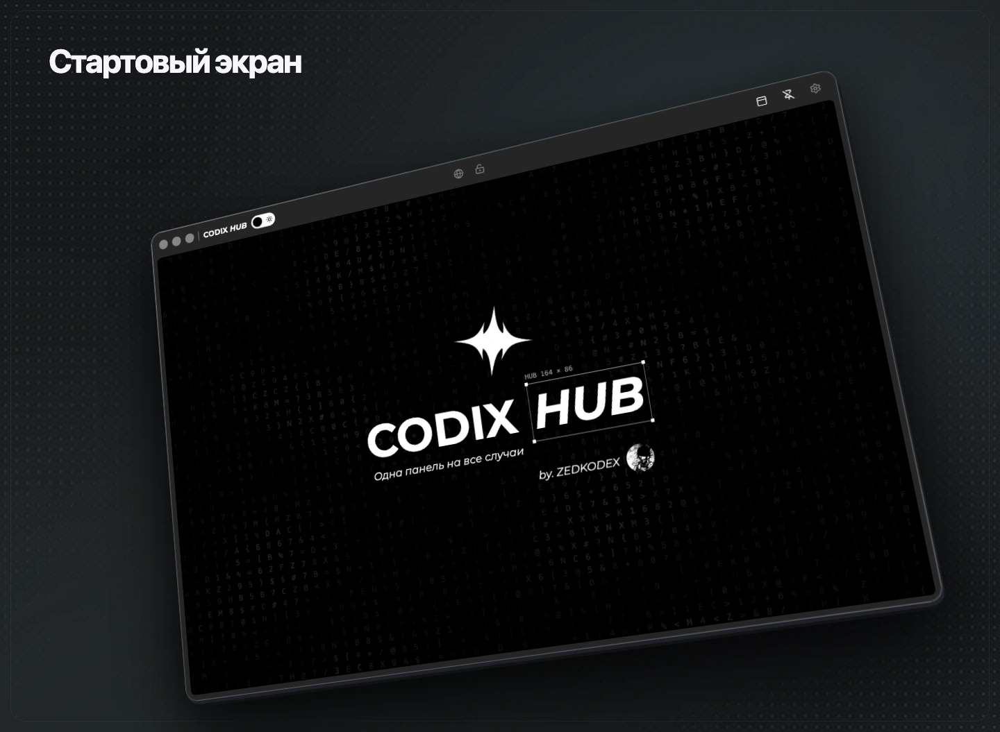
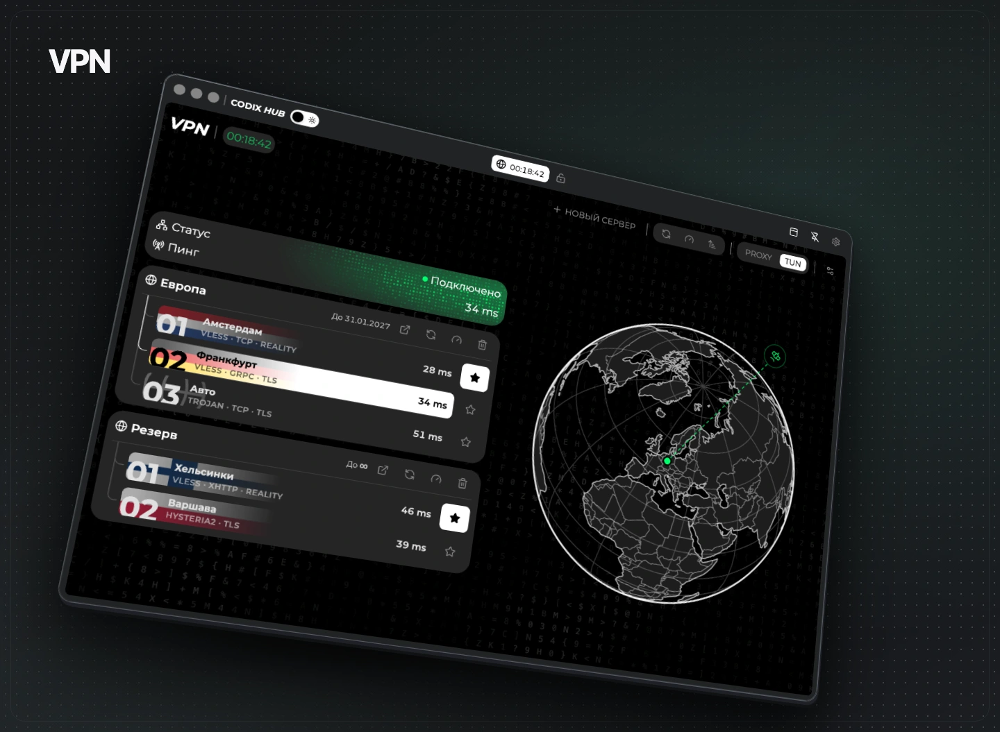
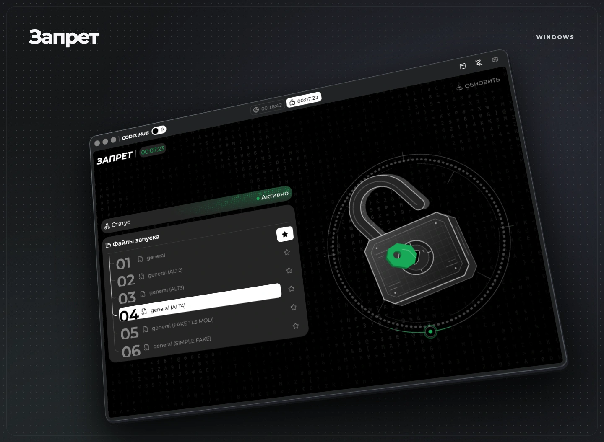
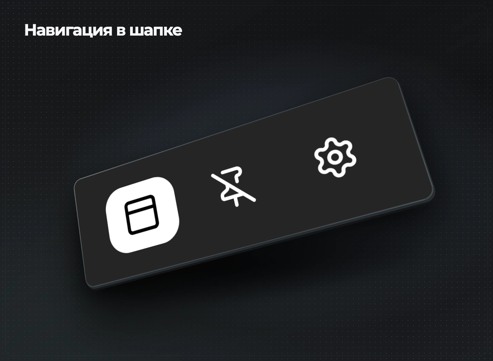
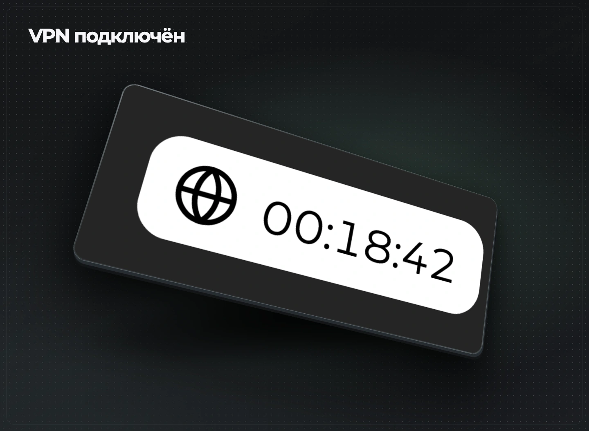
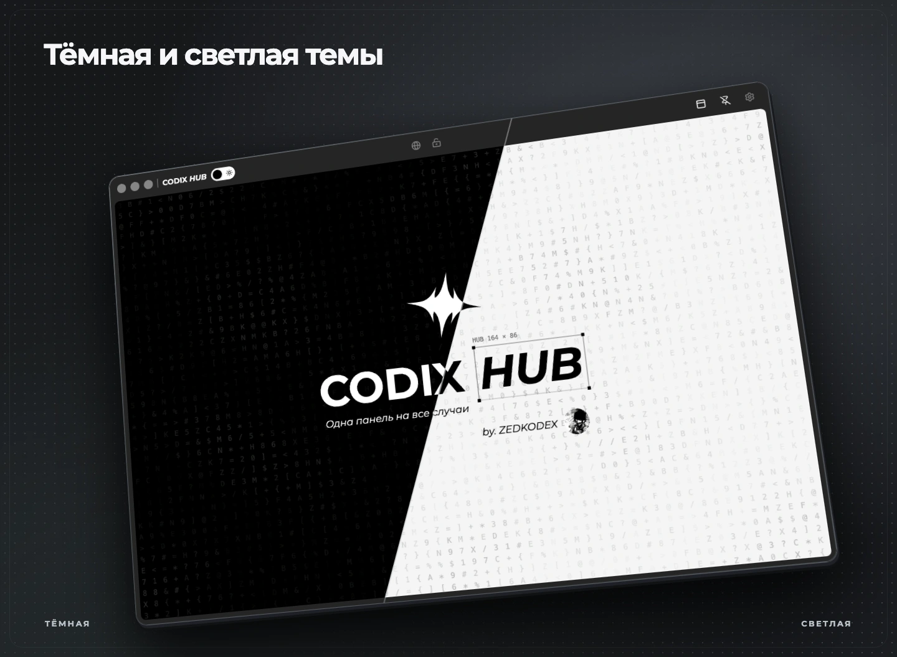

<div align="center">

# CODIX HUB

**VPN и Запрет в одном настольном приложении**


[Установка](#установка) · [Возможности](#возможности) · [Интерфейс](#интерфейс) · [Последний релиз](https://github.com/KUZURAKI/CODIX-HUB-RELEASES/releases/latest)

</div>



## Установка

Команда для вашей системы скачает последнюю версию из GitHub Releases, установит и запустит приложение.

**macOS** · Терминал

```bash
curl -fsSL https://raw.githubusercontent.com/KUZURAKI/CODIX-HUB-RELEASES/main/install.sh | sh
```

**Windows** · PowerShell

```powershell
irm https://raw.githubusercontent.com/KUZURAKI/CODIX-HUB-RELEASES/main/install.ps1 | iex
```

Для ручной установки скачайте [ZIP для macOS](https://github.com/KUZURAKI/CODIX-HUB-RELEASES/releases/latest/download/CODIX-HUB-macos.zip) или [установщик Windows](https://github.com/KUZURAKI/CODIX-HUB-RELEASES/releases/latest/download/CODIX-HUB-windows-setup.exe).

### Обновление и удаление

Для обновления повторите команду установки. Настройки сохранятся. На macOS приложение можно удалить из «Программ» или `~/Applications`, если оно было установлено туда. В Windows откройте «Параметры» → «Приложения» → «CODIX HUB» → «Удалить».

## Возможности

| Раздел | Что доступно | Системы |
| --- | --- | --- |
| **VPN** | Импорт подписок и ссылок VLESS, VMess, Trojan, Shadowsocks и Hysteria2. Proxy и TUN, избранное, пинг и обновление всех подписок или одной. Видимый срок действия подписки, если поставщик передаёт его. Исключения для сайтов и для приложений на Windows. Ядро Xray скачивается при первом подключении. | Windows и macOS |
| **Запрет** | Выбор и запуск сценария, избранное, обновление Zapret и таймер работы. | Windows |
| **Настройки** | Светлая и тёмная темы, выбор монитора, автозапуск и работа в трее. Меню можно перенести из шапки в левую панель. Таймеры VPN и Запрета можно показать в шапке, в панели или в обоих местах. | Windows и macOS |

Для публичной сборки не нужны регистрация, ключ доступа и сервер CODIX HUB.

### Первое подключение к VPN

Скопируйте ссылку или подписку и нажмите «Новый сервер» в разделе VPN. Выберите сервер из списка и нажмите на глобус. Чтобы видеть время подключения в шапке с любой страницы, включите «Статусы в меню» в настройках и выберите «Шапка» или «Везде».

## Интерфейс

<table>
  <tr>
    <td><a href="screenshots/vpn.webp"></a></td>
    <td><a href="screenshots/zapret.webp"></a></td>
  </tr>
  <tr>
    <td><a href="screenshots/navigation.webp"></a></td>
    <td><a href="screenshots/vpn-timer.webp"></a></td>
  </tr>
</table>



<div align="center">

Сделано **ZEDKODEX**

</div>
